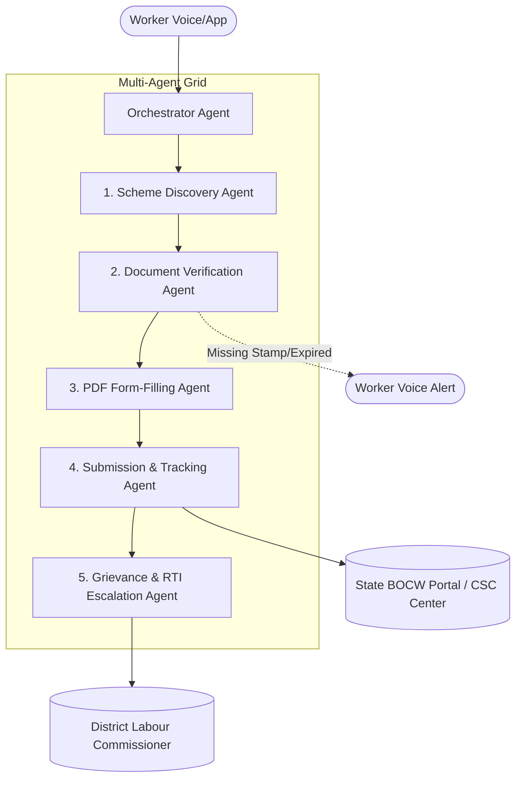

# 🛡️ Suraksha Grid (सुरक्षा ग्रिड) — Comprehensive Audit & AI Integration Blueprint

**Version:** 1.0  
**Date:** October 2026  
**Status:** Architecture Review & Engineering Blueprint  
**Target Domain:** Unorganized & Migrant Labour Social Security, BOCW Act 1996, State Welfare Boards  

---

## 📑 Table of Contents
1. [Executive Summary](#1-executive-summary)
2. [Current Architecture vs. Implementation Reality](#2-current-architecture-vs-implementation-reality)
3. [Deep-Dive: Codebase Shortcomings & Vulnerabilities](#3-deep-dive-codebase-shortcomings--vulnerabilities)
   - [3.1 Architecture & Infrastructure Deficits](#31-architecture--infrastructure-deficits)
   - [3.2 Security, Cryptography & Auth Flaws](#32-security-cryptography--auth-flaws)
   - [3.3 Domain Logic & Statutory Calculations](#33-domain-logic--statutory-calculations)
   - [3.4 User Adoption & Accessibility Barriers](#34-user-adoption--accessibility-barriers)
4. [AI Systems Integration Blueprint](#4-ai-systems-integration-blueprint)
   - [Tier 1: Simple & Immediate AI Integrations (Quick Wins)](#tier-1-simple--immediate-ai-integrations-quick-wins)
   - [Tier 2: Intermediate AI Systems (Data & Operations)](#tier-2-intermediate-ai-systems-data--operations)
   - [Tier 3: Advanced AI Systems (Autonomous Multi-Agent Grid)](#tier-3-advanced-ai-systems-autonomous-multi-agent-grid)
5. [Target System Architecture (Future State)](#5-target-system-architecture-future-state)
6. [Phased Implementation Roadmap & Tech Stack](#6-phased-implementation-roadmap--tech-stack)

---

## 1. Executive Summary

**Suraksha Grid (सुरक्षा ग्रिड)** addresses one of India's most critical social security challenges: delivering portable benefits, verifiable work seniority, and union/board continuity to over **60 million unorganized and migrant workers** covered under the Building and Other Construction Workers (BOCW) Act, 1996.

The foundational vision—Aadhaar-linked portable identity, conversion of daily attendance into statutory seniority (90 work-days = 1 BOCW year), and multi-state benefit eligibility discovery—is conceptually sound. However, the current technical implementation suffers from critical gaps:
1. **Serverless Ephemeral Storage**: Using local SQLite in `/tmp` causes state loss on serverless cold starts.
2. **Cryptographic e-KYC Verification Gap**: Aadhaar XML files are parsed without UIDAI signature validation, exposing the system to identity spoofing.
3. **Unprotected Backend Services**: Go microservice endpoints lack authentication and role-based access checks.
4. **Mocked Dashboards**: Contractor and Supervisor portals operate almost entirely on client-side mock data.
5. **Real-world Usability Mismatch**: Desktop browser-based XML ZIP uploads are inaccessible to daily-wage construction workers.

By remedying core infrastructure and integrating modern AI systems (multimodal OCR, voice assistants, statutory RAG, and autonomous multi-agent claims processing), Suraksha Grid can transition from a prototype into an enterprise-ready national infrastructure platform.

---

## 2. Current Architecture vs. Implementation Reality

### Claimed Architecture (README.md)
* **API Gateway:** Python FastAPI (Port 5000)
* **Business Engine:** Go Gin (Port 8080) with CRON daemon
* **Databases:** 3 physically isolated MySQL instances (`common_db:3306`, `home_labor_db:3307`, `contractors_master:3308`) orchestrated via Docker Compose.

```
[React SPA] ---> [FastAPI Gateway :5000] ---> [Go Gin Engine :8080]
                                                      │
                       ┌──────────────────────────────┼──────────────────────────────┐
                       ▼                              ▼                              ▼
             MySQL: common_db              MySQL: home_labor_db          MySQL: contractors_master
```

### Actual Codebase Implementation (Vercel Serverless)
* **Frontend:** React 19 + Vite 7 SPA hosted on Vercel.
* **API Gateway (`api/index.py`):** FastAPI app proxying calls via `httpx` to `/api/go/...`.
* **Business Service (`api/go/index.go`):** Gin router embedding a single SQLite database (`suraksha.db`), which is copied to `/tmp/suraksha.db` on cold boot.
* **Databases:** A single local SQLite database file; no multi-database MySQL cluster or Docker Compose files present in the active repository.

```
[Browser React SPA]
        │
        ├──> /api/*    ---> [api/index.py (FastAPI)] ──(HTTP)──┐
        │                                                      ▼
        └──> /api/go/* ───────────────────────────────────> [api/go/index.go (Gin)]
                                                                    │
                                                            Reads/Writes to
                                                                    ▼
                                                          /tmp/suraksha.db (Ephemeral!)
```

---

## 3. Deep-Dive: Codebase Shortcomings & Vulnerabilities

### 3.1 Architecture & Infrastructure Deficits

1. **State Disappearance on Serverless Restarts (`/tmp/suraksha.db`)**:
   * In `api/go/index.go`:
     ```go
     dbPath := filepath.Join(os.TempDir(), "suraksha.db")
     err = os.WriteFile(dbPath, dbBytes, 0644)
     db, err = sql.Open("sqlite", dbPath)
     ```
   * **Problem:** In Vercel serverless environments, the container disk `/tmp` is wiped between cold starts and is never shared across concurrent instances. Any new worker registered via `/register` or absence recorded via `/contractor/mark-absent` will be permanently lost when the instance restarts.

2. **Frontend Disconnection (Contractor & Supervisor Dashboards)**:
   * In `src/frontend/contractor.jsx` and `src/frontend/supervisory.jsx`, 100% of the UI (projects, workers, proposals, schedules, documents) is hardcoded mock data.
   * There are no backend API routes or database models to support contractor project creation, supervisor assignment, or real-time worker linking.

3. **Missing Automated Attendance Daemon**:
   * The "Daily Attendance Pulse" CRON job described in the README does not exist in `api/go/index.go`. Serverless functions cannot run long-lived background daemons.

---

### 3.2 Security, Cryptography & Auth Flaws

1. **Unsigned Aadhaar Offline e-KYC (Identity Spoofing Vulnerability)**:
   * In `api/index.py` (`process_ekyc_zip`) and `src/frontend/registrationPage.jsx`:
     * The system unpacks the ZIP using the share code and parses `<UidData>` attributes (`name`, `dob`, `gender`, `state`).
     * **Flaw:** The server **does not verify UIDAI's digital signature (`ds:Signature`)** using UIDAI's public X.509 certificate.
     * **Impact:** Anyone can craft an XML file with arbitrary demographic information, zip it with any password, and bypass KYC to generate valid worker profiles.

2. **Completely Unauthenticated Go Microservice**:
   * In `api/go/index.go`:
     ```go
     apiGroup.GET("/worker/benefits/:ref_id", getEligibleBenefits)
     apiGroup.POST("/contractor/mark-absent", markAbsent)
     apiGroup.GET("/worker/profile/:ref_id", getWorkerProfile)
     ```
   * **Flaw:** These endpoints do not validate JWT tokens or check caller identity.
   * **Impact:** Any client knowing a `ref_id` can access worker Personally Identifiable Information (PII), union memberships, and benefits data.

3. **Hardcoded JWT Secret Key**:
   * In `api/index.py`:
     ```python
     secret_key = 'heK4w-rrU72qIuGNMerPm762yPayLkvRisjsU-R9ZTs'
     ```
   * **Flaw:** Secrets committed directly to source control pose a severe security risk. Tokens can be forged by anyone with repository access.

4. **Overly Permissive CORS**:
   * `origins = ["*"]` combined with `allow_credentials=True` leaves the API exposed to Cross-Origin attacks.

---

### 3.3 Domain Logic & Statutory Calculations

1. **Overly Simplistic Seniority Formula**:
   * In `api/go/index.go`:
     ```go
     seniorityYears := totalDays / 90
     ```
   * Integer division truncates progress (e.g., 89 days results in 0 years).
   * Real BOCW regulations require tiered rules: active continuous contribution periods, worker age limits (18–60 years), trade categorization, and specific family eligibility criteria (maternity vs. education scholarships).

2. **Attendance Lifecycle Incompleteness**:
   * The Go backend provides only a `/contractor/mark-absent` endpoint. There is no route to record clock-in attendance, verify contractor authorization, resolve worker disputes, or review attendance history logs.

---

### 3.4 User Adoption & Accessibility Barriers

1. **ZIP & Share-Code Complexity**:
   * Unorganized construction workers typically cannot navigate the UIDAI resident portal, download offline XML ZIP archives, and handle 4-digit share codes on a smartphone or desktop.
   * In reality, workers possess physical Aadhaar cards, e-Shram cards, or BOCW yellow passbooks.
2. **Language and Literacy Barrier**:
   * The web application is exclusively in English and relies heavily on text tables. Construction and agricultural workers need voice navigation and regional Indian language support (Hindi, Marathi, Bhojpuri, Bengali, Tamil, etc.).

---

## 4. AI Systems Integration Blueprint

Integrating AI can transform Suraksha Grid from a passive record-keeper into an active, protective digital advocate for unorganized workers. Below is the phased integration hierarchy:

```
┌────────────────────────────────────────────────────────────────────────┐
│                        AI INTEGRATION HORIZONS                         │
├────────────────────────────────────────────────────────────────────────┤
│ TIER 1: SIMPLE (Quick Wins & UX Enablers)                              │
│  • Multimodal Document OCR (Aadhaar / e-Shram / BOCW Passbook)        │
│  • Vernacular Voice Assistant (Bhashini / Whisper + Gemini TTS)        │
│  • Plain-Language Benefit Explainer (Conversational Eligibility)       │
├────────────────────────────────────────────────────────────────────────┤
│ TIER 2: INTERMEDIATE (Operational & Predictive Intelligence)           │
│  • RAG Knowledge Engine over State BOCW Acts & Circulars               │
│  • Edge Biometric & Geofenced Anti-Ghost Worker Attendance             │
│  • Predictive Seniority & WhatsApp Proactive Alerts                    │
├────────────────────────────────────────────────────────────────────────┤
│ TIER 3: ADVANCED (Autonomous Multi-Agent Grid)                         │
│  • Autonomous Welfare Claims & Grievance Multi-Agent System            │
│  • Graph Anomaly & Contractor Fraud Detection Engine                   │
│  • Cross-State Wage Parity & Inter-State Migration Agent               │
└────────────────────────────────────────────────────────────────────────┘
```

---

### Tier 1: Simple & Immediate AI Integrations (Quick Wins)

#### 4.1.1 Multimodal Document OCR & Instant Onboarding
* **Purpose:** Replace the complex Aadhaar XML ZIP upload with a 1-click mobile camera scan.
* **Technology:** Gemini 2.5 Flash / Vision LLM via Python FastAPI endpoint `/api/ai/scan-document`.
* **Workflow:**
  1. Worker or supervisor photographs physical ID (Aadhaar Card, e-Shram Card, or BOCW registration booklet).
  2. The Vision model processes the image with structured extraction:
     ```json
     {
       "document_type": "ESHRAM_CARD",
       "uan_number": "1234-5678-9012",
       "name": "Ramesh Kumar",
       "dob": "1988-06-15",
       "gender": "Male",
       "primary_occupation": "Building and Construction Worker",
       "state": "Maharashtra",
       "confidence_score": 0.98
     }
     ```
  3. Pre-fills registration forms immediately, eliminating manual data entry.

#### 4.1.2 Vernacular Voice-First Assistant (Bhashini / Gemini Voice)
* **Purpose:** Overcome illiteracy and language barriers for unorganized migrant workers.
* **Technology:** 
  * Speech-to-Text: Bhashini ASR / OpenAI Whisper
  * Conversational Engine: Gemini 2.5 Flash
  * Text-to-Speech: Bhashini TTS / Sarvam AI
* **User Experience:**
  * Worker taps a prominent microphone button on the dashboard.
  * Worker speaks in native dialect: *"मुझे बेटी की शादी के लिए पैसा मिल सकता है क्या?"*
  * The system checks database records and responds by voice in Hindi:
    > *"हाँ रमेश जी! आपके 130 दिन पूरे हो चुके हैं। आप महाराष्ट्र BOCW योजना के तहत ₹25,000 विवाह सहायता के लिए पात्र हैं।"*

#### 4.1.3 Plain-Language Generative Benefit Explainer
* **Purpose:** Convert dense legal jargon (e.g., *"Eligibility subject to Sec 18(1) BOCW Act 1996 with 90 days statutory presence"*) into simple, actionable guidance.
* **Output Example:**
  * *"इस योजना के लिए आपको पिछले 12 महीनों में केवल 10 दिन और काम करना है। आवश्यक दस्तावेज: आधार कार्ड और बैंक पासबुक।"*

---

### Tier 2: Intermediate AI Systems (Data & Operations)

#### 4.2.1 RAG (Retrieval-Augmented Generation) Knowledge Base
* **Purpose:** Keep up with dynamic state-specific BOCW notifications, welfare board rate revisions, and High Court labour directives across all 28 states.
* **Architecture:**
  * **Document Store:** Official PDF gazette circulars, BOCW board bye-laws, High Court rulings.
  * **Vector Database:** PostgreSQL with `pgvector` or ChromaDB.
  * **Chunking & Embeddings:** Recursive text chunking with `text-embedding-004`.
  * **Retrieval Flow:** Hybrid search (BM25 keyword + cosine semantic similarity) with cross-encoder re-ranking.
* **Capabilities:** 
  * Workers, union leaders, and contractors can ask specific questions and receive verified answers with page citations to government gazettes.

#### 4.2.2 Geofenced Face Liveness Attendance (Anti-Ghosting AI)
* **Purpose:** Prevent contractor fraud where phantom workers are logged to skim BOCW cess funds or welfare subsidies.
* **Architecture:**
  * Edge face verification via MediaPipe / FaceNet on contractor/supervisor mobile devices.
  * Passive liveness verification (blink/head turn detection) to prevent photo spoofing.
  * GPS coordinates must fall within a 50-meter radius of the registered jobsite polygon.

#### 4.2.3 Predictive Seniority & Milestone Forecasting
* **Purpose:** Proactively notify workers before benefit deadlines or when approaching tier milestones.
* **Model:** Time-series cadence model tracking seasonal construction cycles and harvest migration patterns.
* **Trigger:** When a worker is within 15 days of unlocking a statutory tier, an automated WhatsApp/SMS alert is dispatched with clear instructions.

---

### Tier 3: Advanced AI Systems (Autonomous Multi-Agent Grid)

#### 4.3.1 Autonomous Welfare Claim & Grievance Multi-Agent System
Built using stateful multi-agent orchestration (e.g., LangGraph or CrewAI):



* **Agent Roles & Responsibilities:**
  1. **Scheme Discovery Agent:** Analyzes the worker's verified days, state, trade, and family profile to select maximum-value benefits.
  2. **Document Verification Agent:** Validates uploaded certificates, checking for stamp authenticity, legible seals, and expiration dates.
  3. **Form-Filling Agent:** Automatically renders official state government BOCW PDF application forms with pre-filled fields.
  4. **Submission & Tracking Agent:** Interfaces with state labour board APIs or Common Service Centers (CSC) and tracks application reference tokens.
  5. **Grievance & RTI Escalation Agent:** If an application remains pending past the statutory deadline (e.g., 30 days under the state's Right to Public Services Act), the agent automatically drafts an RTI inquiry or formal grievance to the District Labour Commissioner.

#### 4.3.2 Graph Neural Network (GNN) Fraud & Collusion Detection
* **Purpose:** Detect syndicate operations, double-dipping, and fictitious jobsites.
* **Graph Representation:**
  * Nodes: Workers, Contractors, Jobsites, Labour Unions.
  * Edges: Attendance logs, Employer-employee linkages, Welfare claims.
* **Detection Targets:**
  * Spatiotemporal anomalies (e.g., same worker logged in Pune and Lucknow on the same afternoon).
  * Contractor clusters with abnormally high claim rates or zero project completion.

---

## 5. Target System Architecture (Future State)

```
┌────────────────────────────────────────────────────────────────────────┐
│                        CLIENT LAYER (Cross-Device)                     │
│  • PWA React Frontend (Mobile-First)   • Vernacular Voice Interface    │
│  • WhatsApp / SMS Gateway              • Contractor Android Edge App   │
└───────────────────────────────────┬────────────────────────────────────┘
                                    │
┌───────────────────────────────────▼────────────────────────────────────┐
│                  FASTAPI API GATEWAY & ORCHESTRATION                   │
│  • JWT Auth & RBAC Middleware          • Rate Limiting & Audit Logging │
│  • Cryptographic XML Signature Check   • AI Service Router             │
└─────────────┬───────────────────────────────────────────┬──────────────┘
              │                                           │
┌─────────────▼───────────────┐           ┌───────────────▼──────────────┐
│     GO BUSINESS ENGINE      │           │          AI SERVICES         │
│  • Statutory Seniority Calc │           │  • Multimodal Vision OCR     │
│  • Jobsite & Attendance API │           │  • Vernacular Voice Agent    │
│  • Real-Time Event Bus      │           │  • RAG Knowledge Engine      │
│  • Worker-Union Portability │           │  • Autonomous Claims Agents  │
└─────────────┬───────────────┘           └───────────────┬──────────────┘
              │                                           │
┌─────────────▼───────────────────────────────────────────▼──────────────┐
│                         DATA & PERSISTENCE LAYER                       │
│  • PostgreSQL (Core DB, Relational Schemas, JSONB Profiles)            │
│  • pgvector (BOCW Scheme & Gazette Circular Embeddings)                │
│  • Redis (Session Cache, Token Denylist, Rate Limit Counters)          │
│  • S3 / Cloud Storage (Encrypted Worker Document Vault)                │
└────────────────────────────────────────────────────────────────────────┘
```

---

## 6. Phased Implementation Roadmap & Tech Stack

### Phase 1: Core Foundation & Security Hardening (Weeks 1–3)
- [ ] Migrate from ephemeral SQLite to persistent **PostgreSQL** (e.g., Supabase / Neon / AWS RDS).
- [ ] Implement XML digital signature verification in `api/index.py` using `signxml` and UIDAI's public certificate.
- [ ] Secure JWT secret management via environment variables (`JWT_SECRET`).
- [ ] Add JWT authentication middleware to all Go Gin endpoints in `api/go/index.go`.
- [ ] Restrict CORS policies to legitimate frontend domains.

### Phase 2: Usability & Tier 1 AI Integrations (Weeks 4–6)
- [ ] Deploy multimodal OCR endpoint for physical Aadhaar, e-Shram, and BOCW passbooks.
- [ ] Integrate Bhashini / Whisper voice input with Gemini conversational responses.
- [ ] Wire up real backend APIs for `contractor.jsx` and `supervisory.jsx` (jobsites, workers, clock-ins).
- [ ] Add Hindi and regional language localization toggles.

### Phase 3: Statutory Knowledge RAG & Smart Attendance (Weeks 7–10)
- [ ] Set up `pgvector` indexing of state BOCW welfare rules, gazette notifications, and forms.
- [ ] Implement hybrid search (semantic + keyword) with conversational citations.
- [ ] Build geofenced edge attendance verification with anti-spoofing face liveness on contractor mobile devices.
- [ ] Implement proactive WhatsApp notification cron jobs for milestone updates.

### Phase 4: Autonomous Claims & Multi-Agent Governance (Weeks 11–16)
- [ ] Deploy the autonomous multi-agent claims and form-filling system using LangGraph.
- [ ] Integrate automated RTI and grievance escalation workflows.
- [ ] Deploy graph-based fraud and anomaly detection across contractor networks.

---

*Authored for the Suraksha Grid Engineering & Social Impact Team.*  
